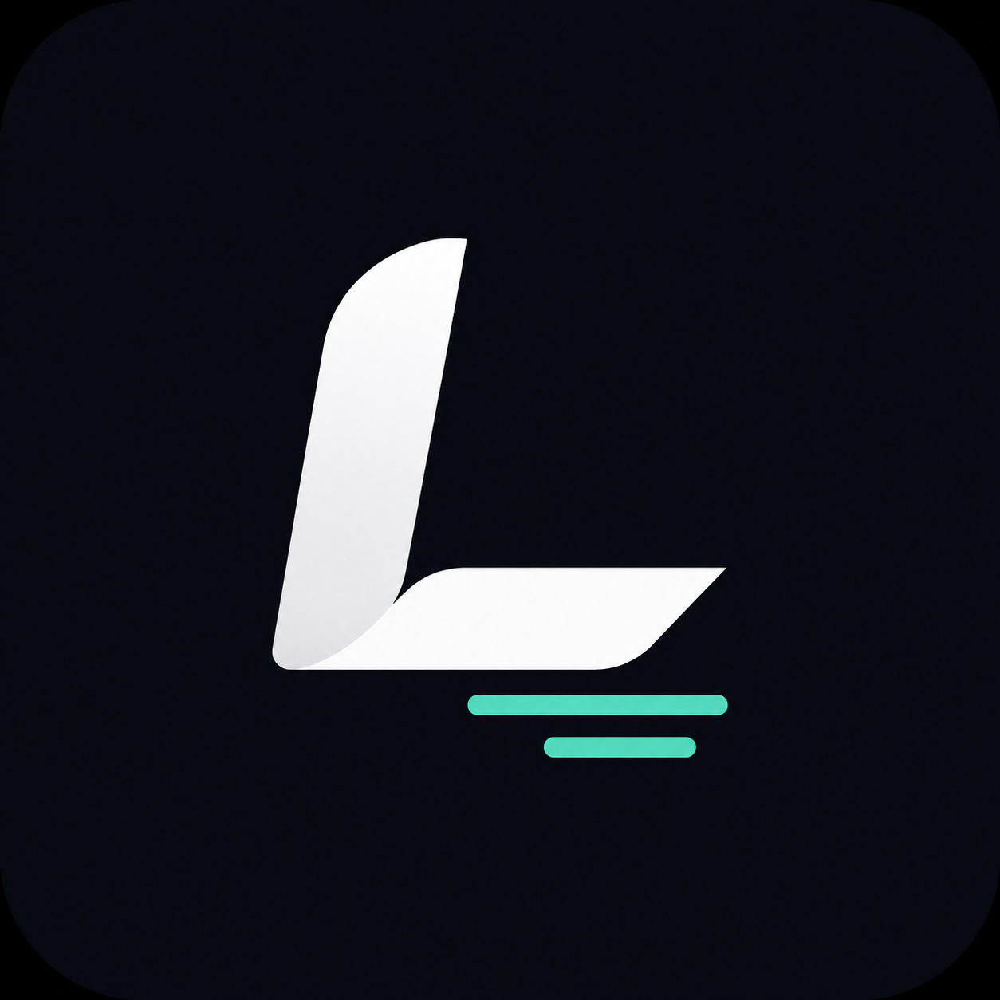

<br />
<div align="center">
  <a href="https://localsubs.aidenw.me">
    
  </a>

  <h3 align="center">LocalSubs</h3>

  <p align="center">
Free English and Traditional Chinese dual subtitles for HBO Max on macOS and Windows.
Keep the original dialogue on screen while Taiwan-optimized Traditional Chinese fills in what you miss. Translation runs locally on your device.

<br />

<a href="https://arxiv.org/abs/2607.09957">
  
</a>
<a href="https://huggingface.co/Aiden1020/Sotto-EN-ZH-TW-0.6B">
  
</a>
<a href="https://huggingface.co/spaces/Aiden1020/localsubs-en-zh-tw-translation">
  
</a>
<a href="https://localsubs.aidenw.me">
  
</a>

<br />
    
  </p>
</div>

https://github.com/user-attachments/assets/5bf883fb-ed50-43f2-a052-47e8f2c9c415

## Requirements

- macOS (Apple Silicon or Intel), or Windows 10/11 x64
- Chrome / Chromium / Microsoft Edge

## Inference architecture

The MV3 background service worker owns the inference router and exposes one
translation interface to the content script. It supports two backends:

- `webllm` is the default for new installations. It runs the MLC model in the
  extension service worker through WebGPU and does not require the Go helper.
- `native` connects to `localsubs_helper` through Chrome Native Messaging and
  runs llama.cpp on CPU or NVIDIA CUDA. Updates preserve this backend for users
  who installed an earlier native-only extension.

The WebLLM backend is GPU-only. The browser must expose a WebGPU adapter with
the `shader-f16` feature; there is no WebLLM CPU fallback. Unsupported devices
can use the native helper instead. Changing the backend in extension settings
unloads the inactive WebLLM engine or resets the native connection without a
browser restart.

Production uses WebLLM 0.2.84 with model ID
`Sotto-EN-ZH-TW-0.6B-q4f16_1-MLC`, a 256-token context window, and a
16-token output limit. The approximately 290 MB `q4f16_1` weights are loaded
from `mlc-q4f16_1/` in the Hugging Face model repository. The matching WebGPU
model library is bundled as `model-lib.wasm`.

WebLLM artifacts use IndexedDB rather than CacheStorage. The latter cannot
reliably cache the bundled `chrome-extension://` WASM resource. The content
script may preheat an already cached model, but it deliberately does not start
an uncached model download; that download must be initiated from the extension
settings page.

See [WEBLLM_EXPERIMENT.md](./WEBLLM_EXPERIMENT.md) for framework comparisons,
conversion details, benchmark results, and the production parameter choices.

## Installation

Install the [LocalSubs Chrome extension](https://chromewebstore.google.com/detail/localsubs：hbo-max-即時、完全本地/dpacileladlkfgdjbdjdjhgnepicejjb).
New installations use WebLLM by default, so no helper is required. Open
LocalSubs settings to download and prepare the browser model before playback.

The native helper remains available as an optional backend. It offers the
lowest latency with the NVIDIA CUDA runtime and provides a fallback when
WebGPU is unavailable. Existing native-helper users remain on that backend
after upgrading.

### Optional native helper: macOS

```bash
brew tap aiden1020/localsubs
brew trust aiden1020/localsubs
brew install localsubs

localsubs setup            # install Chrome integration; choose models in Options
```

> `brew trust` is required because LocalSubs is distributed via a third-party tap.
> It authorizes Homebrew to install formulas from this tap on your machine.

Select **Native helper** in the extension settings after setup.

### Optional native helper: Windows

After the package is listed in the WinGet Community repository, install the
same portable release ZIP without an independent installer or paid code-signing
certificate:

```powershell
winget install --id Aiden1020.LocalSubs --exact
localsubs setup --backend auto
```

Until that listing is approved, download `localsubs_windows_amd64.zip` from the
[GitHub release](https://github.com/aiden1020/localsubs/releases), extract it to
a stable directory such as `%LOCALAPPDATA%\Programs\LocalSubs`, and run:

```powershell
.\localsubs.exe setup --backend auto
```

`auto` downloads the pinned CUDA 12.4 runtime when an NVIDIA GPU is available,
and otherwise downloads the pure CPU runtime. You can force either path with
`--backend cuda` or `--backend cpu`. The downloaded llama.cpp runtime and any
models you choose in Options are checksum-verified and stored under
`%LOCALAPPDATA%\LocalSubs`.

For a manually extracted ZIP, do not move `localsubs.exe` after setup. The
Chrome/Edge Native Messaging registration points to its absolute path. Re-run
`localsubs install` after moving or upgrading it. WinGet manages the executable
location and command alias for WinGet installations.

Select **Native helper** in the extension settings after setup.

## Extension development

Install JavaScript dependencies and run the unit test suite:

```bash
npm ci
npm test
```

Build the production extension, package its reproducible file set, and verify
the ZIP contents:

```bash
npm run build:extension
npm run package:extension
npm run smoke:extension
npm run check:extension-reproducibility
```

The unpacked production build is written to `dist/extension`, and the Chrome
Web Store archive is written to
`dist/localsubs-chrome-extension-v<version>.zip`. The production build excludes
all experiment pages, benchmark datasets, wllama runtimes, and localhost
permissions.

Run the real extension lifecycle test in Chrome or Edge:

```bash
npm run test:webllm:extension
npm run test:webllm:extension -- --warmup --remote
```

The first command checks backend selection and capability reporting without
downloading a model. The second downloads the published Hugging Face artifacts,
then verifies model storage, engine initialization, and a translation request.
Omit `--remote` to serve pre-converted artifacts from
`dist/LocalSubs-EN-ZH-TW-0.6B-q4f16_1-current-MLC` instead. Add `--headed` to
keep the browser UI visible while the test runs.

Experiment bundles are built separately and never enter the production ZIP:

```bash
npm run build:extension:experiments
npm run test:webllm:benchmark -- --headed
npm run test:wllama:standalone -- --headed
```

## Commands

| Command | Description |
|---------|-------------|
| `localsubs setup` | Install the runtime and browser integration; choose models in Options |
| `localsubs runtime download --backend cpu\|cuda` | Download a checksum-verified Windows llama.cpp runtime |
| `localsubs runtime status [--json]` | Inspect the installed CPU and CUDA runtimes |
| `localsubs model download [--channel ID]` | Download an official catalog model |
| `localsubs install` | Install the Chrome Native Messaging integration |
| `localsubs uninstall [--browser all]` | Remove browser integrations but preserve downloaded data |
| `localsubs uninstall --purge --yes` | Remove integrations, models, runtimes, logs, and settings |
| `localsubs status` | Check the integration, installed helper, runtime, and model |
| `localsubs doctor` | Diagnose the manifest, launcher, helper, runtime, and model |
| `localsubs logs` | Print log file paths |
| `localsubs version` | Print version |
| `localsubs benchmark --backend cpu\|cuda\|metal` | Benchmark llama.cpp with a subtitle JSONL set |

The native helper starts on demand when Chrome connects to it; it is not a
persistent background service. Use `localsubs status` to validate the installed
helper, runtime, and model, or `localsubs doctor` for detailed diagnostics and
suggested fixes. Both commands support `--json` for scripts and bug reports.
`localsubs doctor` exits with a nonzero status when a required component fails.
Use `localsubs doctor --deep` to temporarily start `llama-server`, load the
installed model, and run a test inference. The deep check can take up to 90
seconds and always stops the temporary process before exiting.

To configure Chromium or Microsoft Edge instead of Chrome, run
`localsubs setup --browser chromium` or `localsubs setup --browser edge`.

Before removing the Windows package, disconnect browser integrations. Add
`--purge --yes` only when you also want to delete the downloaded model and
runtime:

```powershell
localsubs uninstall
winget uninstall --id Aiden1020.LocalSubs --exact
```

## Model

LocalSubs uses [Sotto-EN-ZH-TW-0.6B](https://huggingface.co/Aiden1020/Sotto-EN-ZH-TW-0.6B), a fine-tuned model optimized for subtitle-length English → Traditional Chinese translation. The higher-quality [Sotto-EN-ZH-TW-1.7B](https://huggingface.co/Aiden1020/Sotto-EN-ZH-TW-1.7B) is available as an optional native helper model for GPUs.

WebLLM uses the browser-optimized `q4f16_1` MLC artifacts. The optional native
helper offers official GGUF models that can be downloaded, selected, and
removed from Options:

```text
Sotto-EN-ZH-TW-0.6B-Q5_K_M.gguf   (default, about 381 MB)
Sotto-EN-ZH-TW-1.7B-Q5_K_M.gguf   (optional `1.7b` channel, about 1.13 GB)
```

If you previously installed an older helper, upgrade it and refresh the Native
Messaging registration. Choose a model to download from Options:

```bash
brew update
brew upgrade localsubs
localsubs install
```

The previous GGUF file is not removed automatically. After verifying that the new model works, you may delete the old model from `~/Library/Application Support/LocalSubs/models/`.

On Windows, models are stored in `%LOCALAPPDATA%\LocalSubs\models`.

## Latency benchmark

The CLI includes a built-in 100-case subtitle workload, so installed releases
do not need a separate dataset file. Run the CPU, macOS Metal, and NVIDIA CUDA
paths independently so the report records startup time, per-case latency,
P50/P90/P95/P99, throughput, output, and exact match:

```bash
localsubs benchmark --backend cpu --output benchmark-results/macos-cpu.json
localsubs benchmark --backend metal --output benchmark-results/macos-metal.json
```

```powershell
localsubs benchmark --backend cpu --output benchmark-results\windows-cpu.json
localsubs benchmark --backend cuda --output benchmark-results\windows-cuda.json
```

The JSON report includes the pinned llama.cpp build, model and dataset SHA-256,
hardware information, GPU offload layer count, and every measured sample.
Pass `--dataset <path>` to benchmark a custom JSONL workload instead.

Windows browser E2E results for Chrome and Edge, including CPU, CUDA, automatic
fallback, and process cleanup, are recorded in
[`e2e-results/README.md`](./e2e-results/README.md).

## Technical Report

The model design, subtitle-domain tokenizer, training procedure, and evaluation are described in [*Workload-Driven Optimization for On-Device Real-Time Subtitle Translation*](https://arxiv.org/abs/2607.09957).

If you use LocalSubs in research, please cite:

```bibtex
@misc{wong2026localsubs,
  title         = {Workload-Driven Optimization for On-Device Real-Time Subtitle Translation},
  author        = {Tsz-To Wong},
  year          = {2026},
  eprint        = {2607.09957},
  archivePrefix = {arXiv},
  primaryClass  = {cs.CL},
  doi           = {10.48550/arXiv.2607.09957},
  url           = {https://arxiv.org/abs/2607.09957}
}
```

## License

Apache 2.0 — see [LICENSE](./LICENSE).

See also the [privacy statement](./PRIVACY.md) and [security policy](./SECURITY.md).
